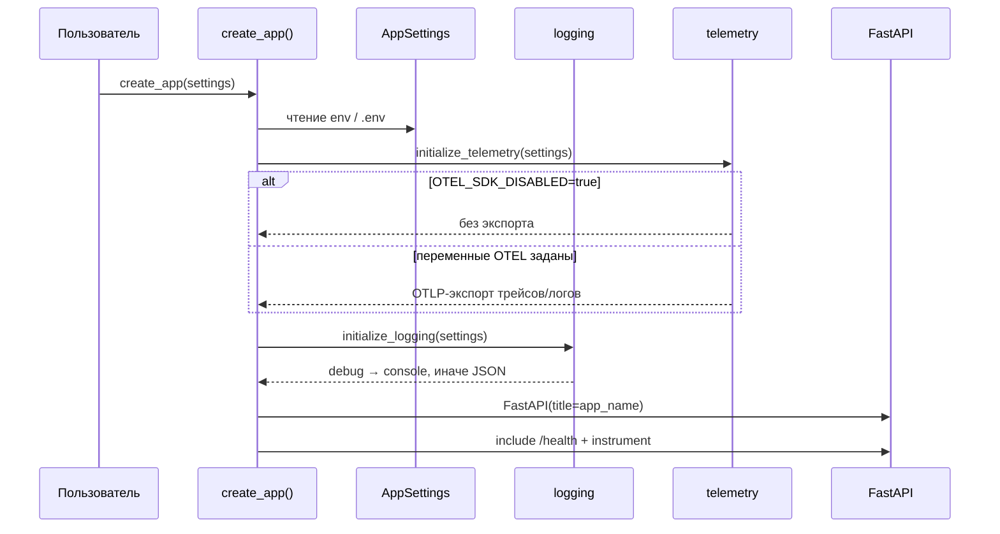

# Design

[[_TOC_]]

## Context

Репозиторий пустой (только заготовка OpenSpec). Создаётся шаблон с нуля. Мотивация и состав — в `proposal.md`; требования — в `specs/project-generation` и `specs/service-scaffold`.

```mermaid
flowchart LR
    subgraph TemplateRepo["Репозиторий шаблона"]
        CopierCfg["copier.yml"]
        Tmpl["template/ (jinja-файлы)"]
        Mk["Makefile (codegen, lock)"]
    end
    subgraph Generated["Сгенерированный проект"]
        App["FastAPI-приложение"]
        Cfg["AppSettings (.env / env)"]
        Log["structlog-логирование"]
        Tel["OpenTelemetry (опционально)"]
        Qa["ruff + mypy + pytest"]
        Docker["Dockerfile / compose"]
    end
    Dev["Разработчик"] -- "copier copy" --> TemplateRepo
    TemplateRepo -- "рендер параметров" --> Generated
    Generated -- "make lint / test / run" --> Dev
```



## Goals / Non-Goals

**Goals:**

- Однокомандная генерация проекта через Copier с минимальным набором параметров (имя приложения, версия Python)
- Сгенерированный проект самодостаточен: без внешних приватных зависимостей, registry, инфраструктурных сервисов
- Сразу после генерации работают: тесты, линтер, mypy, сборка Docker-образа, compose, devcontainer
- «Обвязка» (приложение, настройки, логирование, телеметрия) — обычный код внутри проекта, который пользователь может менять свободно

**Non-Goals:**

- Библиотека-ядро с семантическим версионированием (обвязка встраивается в каждый проект; дивергенция между проектами допустима и является осознанным trade-off)
- Kubernetes/helm, service discovery, секрет-хранилища, GPU, ML-специфика (загрузка моделей из S3)
- Мульти-платформенный CI матрицей версий Python (одна целевая версия)

## Decisions

### Шаблонизатор — Copier

Copier с `copier.yml` и каталогом `template/`. Ответы сохраняются в `.copier-answers.yml` внутри проекта → повторная генерация идемпотентна, обновления шаблона возможны через `copier update`.

_Альтернатива:_ cookiecutter — проще, но нет штатного answers-файла и механики обновления сгенерированных проектов; отклонено.

### Параметры: `app_name` и `python_version`

Два параметра. `app_name` — единственное имя проекта (kebab-case): каталог проекта, Docker-образ, сервис по умолчанию — вычислять производные имена не нужно. На имя пакета имя не влияет: кодовая база плоская (`src/` с модулями верхнего уровня). `python_version` — строка с дефолтом (актуальная стабильная). Минимум параметров сознателен: остальное (описание, автор) проще дописать руками в конкретном проекте, чем выводить из шаблона.

### Плоский layout: `src/` с модулями верхнего уровня

Промежуточного пакета с именем приложения нет — кодовая база сервиса это и есть приложение, лишний уровень вложенности не нужен. Импорты — через `PYTHONPATH=src` (в Docker, compose, VS Code, pytest, Makefile). Структура:

```
src/
├── api/
│   ├── __init__.py
│   ├── app.py          # create_app()
│   └── routers/
│       ├── __init__.py
│       └── health.py   # GET /health
├── settings.py         # AppSettings + get_settings()
├── log.py              # initialize_logging()
├── telemetry.py        # initialize_telemetry()
└── main.py             # точка входа uvicorn
```



_Альтернатива:_ пакетный layout `src/{{app_name}}/` — имя приложения дублируется в каждом импорте (`from my_app.core.settings import ...`), а пакет из одного сервиса не нужен никому, кроме самого сервиса; отклонено. Требование `PYTHONPATH=src` принято: оно концентрировано в инфраструктурных файлах (Dockerfile ENV, entrypoint, compose, devcontainer, launch.json, pytest/mypy-конфиги), ручной ввод не нужен.

### Настройки — pydantic-settings, наследование для расширения

`AppSettings(BaseSettings)`: читает `.env` и переменные окружения; поля `app_name` (default — имя проекта), `app_env` (default `local`), `app_debug` (default `false`), `log_level` (default `INFO`, регистронезависимый enum). Вложенный `OtelSettings` с префиксом `OTEL_`. `get_settings()` с `lru_cache`. Пользователь расширяет настройки наследованием — механика показана в `main.py`/тестах.

### Логирование — structlog, выбор формата через `app_debug`

Единая точка `initialize_logging(settings)`: при `app_debug=true` — `ConsoleRenderer` (цветной, человекочитаемый), иначе — `JSONRenderer` (уровень, время, событие, hostname). Конфигурация structlog поверх stdlib logging, uvicorn/fastapi-логгеры — propagate в root.

_Альтернатива:_ logging.dictConfig без structlog — меньше зависимостей, но теряется единый структурный интерфейс; отклонено.

### Телеметрия — OpenTelemetry, явное включение

Без auto-instrumentation (тяжёлая, много магии): только `FastAPIInstrumentor` + OTLP-gRPC экспорт трейсов и логов. Инициализация в `create_app()` через `initialize_telemetry(settings)`: если `OTEL_SDK_DISABLED=true` (дефолт в `.env.example` и тестовом conftest) — ничего не экспортируется; иначе читаются стандартные `OTEL_*`-переменные (`OTEL_EXPORTER_OTLP_ENDPOINT` и пр.). `OTEL_RESOURCE_ATTRIBUTES` выставляется через `setdefault` (service.name из `app_name`, deployment.environment из `app_env`) — явные значения пользователя не затираются. Экспорт логов — через `logging`-handler из opentelemetry-sdk, подключаемый к root-логгеру.

### Dockerfile — multi-stage на публичном базовом образе uv

`FROM ghcr.io/astral-sh/uv:python{{python_version}}-bookworm-slim`. Targets: `dev` (все группы зависимостей + make/git/bash-completion), `builder` (`uv sync --no-dev --frozen`), `release` (non-root `app`-пользователь, .venv + src + entrypoint, `ENTRYPOINT ["./entrypoint.sh"]`, uvicorn на :8000). Никаких приватных mirror'ов. `uv.lock` копируется и остаётся в образе (не удаляется).

_Альтернатива:_ удалять `pyproject.toml`/`uv.lock` после sync (как в прототипе) — экономит ничтожный объём, усложняет отладку; отклонено.

### Тесты — pytest, изоляция телеметрии

`tests/conftest.py` выставляет `OTEL_SDK_DISABLED=true` до импорта приложения и предоставляет фикстуры `app`/`test_client`/`test_client_raise_exceptions`. Базовые тесты: health-endpoint и расширение настроек наследованием. Запуск одной командой `make test` (pytest + coverage).

### Инструменты качества — ruff + mypy strict

ruff: line-length 119, правила W,E,F,I,N,T20,Q + mccabe max-complexity 6, isort combine-as. mypy: `strict = true`, pydantic-плагин. Кодовая база шаблона сама проходит обе проверки. `Makefile` цели: `lint` (ruff + mypy), `fmt`, `test`, `run` (uvicorn локально), `codegen` (генерация тестового проекта в `scratch/` для проверки шаблона).

### Dev-окружение — devcontainer + VS Code

`.devcontainer/devcontainer.json`: build target `dev`, volume для `.venv` (переживает rebuild), bind исходников, проброс :8000, рекомендуемые расширения (python, debugpy, pylance, ruff). `.vscode/launch.json`: конфигурации «uvicorn + debug» и «Debug Tests»; `settings.json`: pytest как test framework.

### CI — GitHub Actions

`.github/workflows/ci.yml`: на push/PR — `make lint` и `make test` через uv. **Допущение:** хостинг — GitHub; при миграции достаточно переписать один workflow-файл.

## Risks / Trade-offs

- [Дивергенция обвязки между проектами после копирования] → осознанный trade-off отказа от библиотеки-ядра; смягчение — обвязка маленькая (4 модуля) и с тестами, копирование дёшево
- [`app_name` — единственное имя, ошибки формата дорого отлаживать в сгенерированном проекте] → валидация kebab-case в `copier.yml`; пакета с этим именем нет, поэтому ограничений идентификатора Python не требуется
- [Рассинхрон версии Python между параметром шаблона и актуальной] → при бампе дефолта перегенерировать `uv.lock` шаблона командой (`make lock`) и прогнать `codegen` + тесты
- [Дрейф версий зависимостей между генерациями] → после генерации автоматически выполняется `uv lock` (задача в `copier.yml`), проект стартует с воспроизводимым набором
- [CI-проверки в шаблоне не гарантируют прохождение в сгенерированном проекте из-за подстановки имён] → задача в tasks: после `codegen` прогонять lint/test в сгенерированном проекте

## Migration Plan

Не применимо — репозиторий создаётся с нуля, мигрировать нечего. Первый релиз = первый коммит шаблона; «откат» на этом этапе — удаление change-артефактов до архивации.

## Open Questions

- Точный дефолт версии Python (`python_version`) зафиксируем при реализации на актуальную стабильную — на спецификацию не влияет
